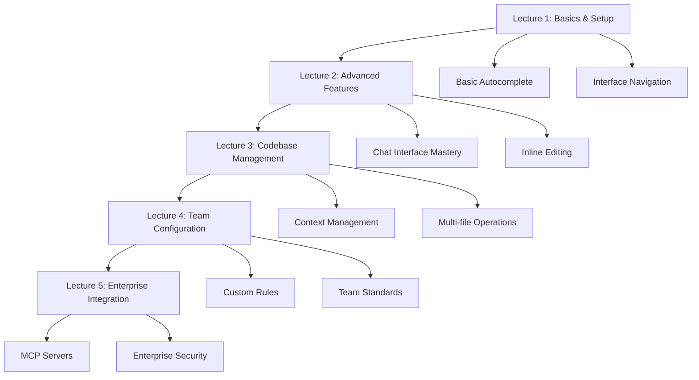

# Cursor AI Development Mastery

> **A comprehensive 5-lecture course for senior developers and tech leads to master AI-assisted development with Cursor**

## 🎯 Course Overview

This professional development course is designed for experienced developers who want to leverage AI to dramatically increase their productivity and code quality. Over 5 focused 30-minute lectures, you'll master Cursor AI from basic features to enterprise-level integration and automation.

### Target Audience

- **Senior Software Developers** (3+ years experience)
- **Tech Leads** and **Team Managers**
- **Software Architects**
- **DevOps Engineers**
- **Development Teams** looking to adopt AI-assisted workflows

### Learning Outcomes

By completing this course, participants will:

- ✅ Master Cursor AI's complete feature set
- ✅ Implement team-wide AI development workflows
- ✅ Configure custom rules and organizational standards
- ✅ Navigate large codebases efficiently with AI assistance
- ✅ Integrate enterprise systems through MCP servers
- ✅ Lead AI adoption initiatives in their organizations

## 📚 Course Structure

### **Lecture 1: Cursor AI Overview & Basic Features** (30 min)

*Foundation and Getting Started*

- Introduction to Cursor AI and its philosophy
- Installation, setup, and workspace configuration
- Core interface overview and navigation
- Basic autocomplete and code generation
- **3 Code Examples**: Function creation, class implementation, API integration

### **Lecture 2: Advanced Chat Interface & Inline Editing** (30 min)

*Advanced Interaction Techniques*

- Master the chat interface for complex development tasks
- Inline editing for precise code modifications
- Code explanation, documentation, and refactoring
- **3 Example Scenarios**: Algorithm explanation, refactoring workflows, documentation generation

### **Lecture 3: Codebase Understanding & Context Management** (30 min)

*Large-Scale Project Navigation*

- Navigate and understand complex codebases with AI
- @folders integration and advanced file referencing
- Multi-file operations and cross-file analysis
- **3 Practical Examples**: Architecture analysis, cross-file refactoring, multi-file operations

### **Lecture 4: Cursor Rules & Configuration** (30 min)

*Team Standards and Customization*

- Create and implement custom Cursor rules
- Build prompts libraries and templates
- Team configuration management strategies
- **3 Configuration Examples**: Basic rules, behavioral configuration, custom prompts

### **Lecture 5: MCP Servers & Enterprise AI Integration** (30 min)

*Enterprise Integration and Automation*

- Understanding and implementing MCP (Model Context Protocol) servers
- Enterprise system integration strategies
- Security, compliance, and scalability considerations
- **3 Integration Examples**: Database setup, custom server development, enterprise planning

## 🛠 Technical Requirements

### Prerequisites

- Senior programming experience (3+ years)
- Familiarity with VS Code or similar IDEs
- Understanding of software development lifecycle
- Experience with team collaboration tools
- Basic knowledge of enterprise development practices

### Recommended Setup

- Cursor AI installed and configured
- Access to development environment
- Sample codebases for practice
- Team collaboration tools (Git, etc.)

## 📊 Course Metrics

| **Metric** | **Value** |
|------------|-----------|
| **Total Duration** | 150 minutes (2.5 hours) |
| **Total Slides** | 53 slides |
| **Lectures** | 5 focused sessions |
| **Code Examples** | 15+ practical examples |
| **Skill Level** | Intermediate to Advanced |
| **Format** | Slide-based with speaker notes |

## 🎓 Learning Path

## 📋 Course Materials

### Included Content

- **53 Professional Slides** with detailed content
- **15+ Code Examples** with real-world scenarios
- **Comprehensive Speaker Notes** for each slide
- **Implementation Checklists** for team adoption
- **Configuration Templates** for quick setup
- **Best Practice Guidelines** for enterprise use

### Practical Examples Cover

- JavaScript/TypeScript development workflows
- Python class implementations and API integrations
- Multi-language project navigation
- Database integration through MCP servers
- Enterprise security and compliance patterns
- Team collaboration and code review processes

## 🚀 Getting Started

### For Instructors

1. Review the complete course materials
2. Set up demonstration environment
3. Prepare live coding examples
4. Configure sample projects for hands-on activities

### For Participants

1. Install Cursor AI from [cursor.sh](https://cursor.sh)
2. Import your existing VS Code settings
3. Prepare sample codebases for practice
4. Set up team collaboration tools

### Course Delivery Options

- **Corporate Training**: Delivered to development teams
- **Workshop Format**: Hands-on sessions with live coding
- **Self-Paced Learning**: Individual study with materials
- **Hybrid Approach**: Combination of instruction and self-study

## 🔒 Enterprise Considerations

### Security & Compliance

- Code privacy and data handling best practices
- Enterprise authentication and access controls
- Audit logging and compliance requirements
- Integration with existing security frameworks

### Team Adoption Strategy

- Gradual rollout and change management
- Training programs and skill development
- Success metrics and productivity measurement
- Ongoing support and continuous improvement

## 📞 Support & Resources

### Additional Resources

- Official Cursor documentation
- Community forums and discussions
- Best practice repositories
- Enterprise support channels

### Course Updates

This course is designed to evolve with Cursor AI's feature development. Regular updates will include:

- New feature coverage
- Enhanced examples and use cases
- Updated enterprise integration patterns
- Community feedback incorporation

---

**Course Version**: 1.0  
**Last Updated**: January 2024  
**Difficulty**: Intermediate to Advanced  
**Format**: Professional slide-based presentation with comprehensive speaker notes

*Ready to transform your development workflow with AI? Let's begin the journey to Cursor AI mastery.*
