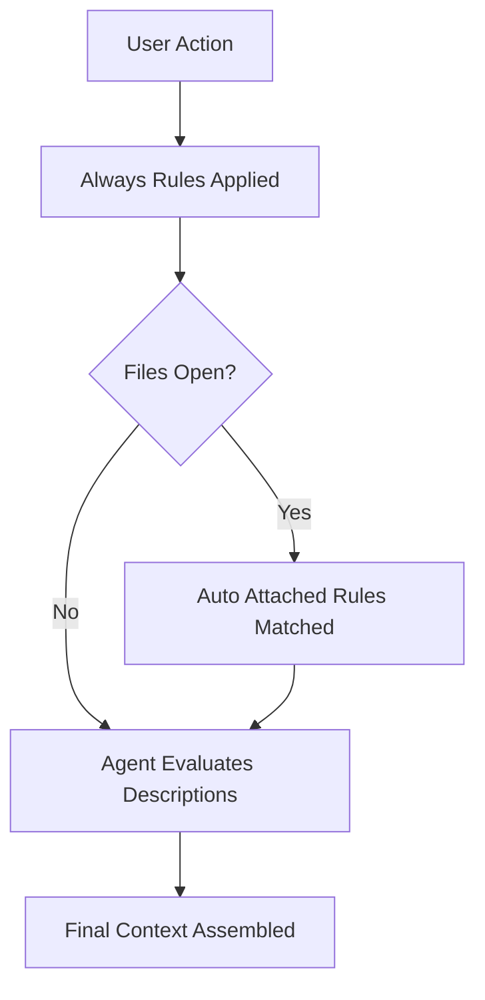

# Code Style Configuration

## Enforcing Consistency

- **Predefined styles**: Airbnb, Google, Standard, etc.
- **Custom styles**: Define your own rules
- **Automatic formatting**: On save or on demand

## Example: Style Rule

```
{
  "style": "airbnb",
  "maxLineLength": 100,
  "semi": false,
  "trailingComma": "all"
}
```

## Best Practices

- Start with a popular style, then customize
- Document exceptions and customizations
- Use version control for rule files

<!-- Speaker Notes:
Code style configuration is one of the most common uses for Cursor rules. By enforcing a consistent style, you reduce code review friction and make your codebase easier to maintain. Cursor supports popular style guides out of the box, but you can always customize them to fit your team's needs.
-->

- ✅ Applied to **every** chat and Cmd-K interaction
- 🎯 Use for: Global coding standards, response tone

### 2. **Auto Attached Rules**

```yaml
description: ""
globs: "**/*.ts,**/*.tsx"
alwaysApply: false
```

- ✅ Applied when files **match glob patterns**
- 🎯 Use for: Language-specific rules, directory conventions

### 3. **Agent Requested Rules**

```yaml
description: "Apply when working with React components..."
globs: ""
alwaysApply: false
```

- ✅ AI **decides** when to apply based on description
- 🎯 Use for: Context-sensitive guidance, domain knowledge

### 4. **Manual Rules**

```yaml
description: ""
globs: ""
alwaysApply: false
```

- ✅ Only included when explicitly mentioned: `@ruleName`
- 🎯 Use for: Templates, specialized workflows

## 🔄 Rule Processing Flow



<!-- Speaker Notes:
The four rule types provide different activation patterns for different use cases.

Always rules are the most powerful but should be used sparingly - they add context to every interaction. Good for global standards.

Auto attached rules activate based on file patterns - excellent for language-specific or directory-specific rules.

Agent requested rules let the AI decide when they're relevant based on the description field. This is powerful for domain-specific knowledge.

Manual rules are only used when explicitly referenced with @ruleName syntax. Great for templates or specialized workflows.

Understanding when each type activates is crucial for building an effective rule system.
-->