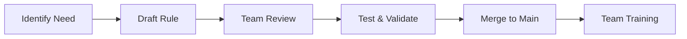

# Team Collaboration & Rule Management

## 🤝 Team Rule Strategies

### **Version Control Integration**

```bash
# Rules are part of your codebase
.cursor/
└── rules/
    ├── team-standards.mdc       # Shared team rules
    ├── code-review.mdc          # Review guidelines  
    └── project-specific.mdc     # Project conventions
```

### **Rule Organization Patterns**

#### **By Domain:**

```
.cursor/rules/
├── frontend/
│   ├── react-patterns.mdc
│   └── styling-guides.mdc
├── backend/
│   ├── api-standards.mdc
│   └── database-rules.mdc
└── shared/
    └── testing-standards.mdc
```

#### **By Priority:**

```
.cursor/rules/
├── critical/          # Always-apply rules
├── recommendations/   # Auto-attached rules
└── templates/         # Manual rules
```

## 🛠️ Rule Management Workflow

### **1. Rule Creation Process**



### **2. Rule Governance**

- 👥 **Rule Ownership:** Assign maintainers per rule category
- 📝 **Change Process:** PR reviews for rule modifications
- 🧪 **Testing:** Validate rules don't conflict
- 📚 **Documentation:** Keep rule rationale updated

### **3. Onboarding New Team Members**

```markdown
# Onboarding Checklist
□ Clone repository with rules
□ Review team-standards.mdc
□ Complete rule training session
□ Pair with experienced developer
□ Test rule application in practice
```

## 🔄 No Built-in Team Sharing (Yet)

### **Current Workarounds:**

- **Git Submodules:** Share rules across repositories
- **Symbolic Links:** Link to shared rule repository
- **Template Repository:** Bootstrap new projects with rules

### **Future:** Cursor plans native team rule sharing

<!-- Speaker Notes:
Team collaboration with Cursor Rules requires thoughtful organization and governance. Since rules are version-controlled, they become part of your team's shared development standards.

The key is organizing rules logically - either by domain (frontend/backend) or by priority level. Having clear ownership and change processes prevents rule conflicts and ensures quality.

Currently, there's no built-in way to share rules across projects, but teams use Git submodules, symbolic links, or template repositories as workarounds.

The onboarding process is crucial - new team members need to understand not just the rules, but why they exist and how to apply them effectively.

Rule governance becomes more important as teams grow - assign owners, require PR reviews for changes, and maintain documentation about rule rationale.
-->