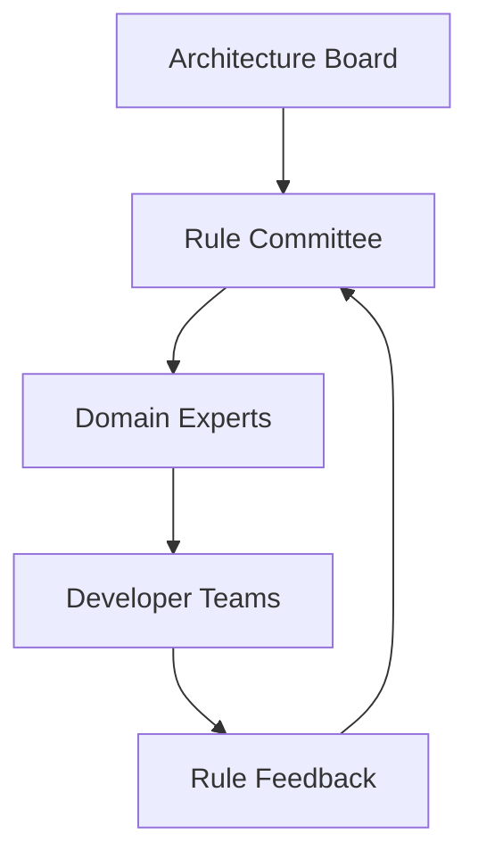

# Enterprise Integration Strategies

## 🏢 Enterprise Rule Architecture

### **Multi-Level Rule Hierarchy**

```
Enterprise Rules Strategy
├── Organization Level    # Company-wide standards
│   ├── Security policies
│   ├── Compliance rules
│   └── Brand guidelines
├── Division Level        # Department-specific
│   ├── Frontend standards
│   ├── Backend patterns
│   └── Data governance
└── Project Level         # Project-specific
    ├── Technical stack
    ├── Feature flags
    └── Performance targets
```

<!-- Speaker Notes:
This slide introduces the multi-level rule hierarchy for enterprise environments. The architecture is designed to support different levels of governance, from organization-wide standards down to project-specific rules. This structure allows for consistent standards across the enterprise while still providing flexibility for individual teams and projects.
-->

## 🏗️ Organizational Deployment

### **1. Rule Distribution Strategy**

| Method | Use Case | Pros | Cons |
|--------|----------|------|------|
| **Git Submodules** | Shared rules across repos | Version control | Complex updates |
| **Internal NPM** | Package-based distribution | Easy versioning | Requires npm setup |
| **Template Repos** | Bootstrap new projects | Standardized setup | Manual updates |
| **Shared Filesystem** | Enterprise environments | Central management | Dependency issues |

### **2. Governance Structure**



## 🚀 Implementation Phases

### **Phase 1: Foundation (Weeks 1-2)**

- ✅ Establish rule committee and governance
- ✅ Create core security and compliance rules
- ✅ Set up rule distribution mechanism

### **Phase 2: Rollout (Weeks 3-6)**

- ✅ Pilot with 2-3 teams
- ✅ Gather feedback and iterate
- ✅ Create training materials

### **Phase 3: Scale (Weeks 7-12)**

- ✅ Deploy to all development teams
- ✅ Monitor compliance and adoption
- ✅ Continuous improvement process

## 📊 Success Metrics

- **Adoption Rate:** % of projects using enterprise rules
- **Compliance Score:** Security/regulatory rule adherence
- **Developer Satisfaction:** Rule usefulness surveys
- **Code Quality:** Defect reduction metrics

<!-- Speaker Notes:
Enterprise deployment requires a structured approach with clear governance and phased rollout. The key is balancing consistency with team autonomy.

Start with security and compliance rules - these are non-negotiable and provide immediate value. Build a rule committee with representatives from architecture, security, and development teams.

Choose your distribution strategy based on your organization's infrastructure. Git submodules work well for companies already using Git extensively, while internal NPM packages suit organizations with strong package management practices.

The governance structure should include feedback loops - rules aren't set in stone and should evolve based on developer experience and changing requirements.

Success metrics help justify the investment and identify areas for improvement. Track both technical metrics (compliance, quality) and human metrics (satisfaction, adoption).
-->