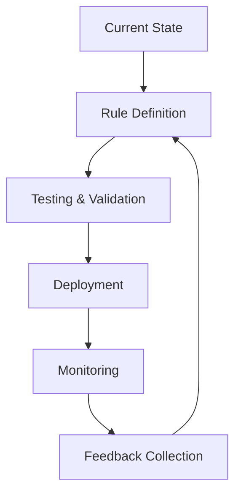

# Organizational Deployment

## 🏗️ Deployment Strategy

### **Phased Rollout**
1. **Pilot Phase** (2-4 weeks)
   - Select 1-2 teams
   - Monitor rule effectiveness
   - Gather feedback

2. **Departmental Rollout** (1-2 months)
   - Expand to entire departments
   - Department-specific adaptations
   - Training sessions

3. **Enterprise Rollout** (3-6 months)
   - Organization-wide deployment
   - Centralized governance
   - Continuous improvement

## 🔄 Change Management

### **Key Stakeholders**
- **Engineering Leadership**: Strategic direction
- **Security Team**: Compliance oversight
- **Platform Team**: Tooling and infrastructure
- **Development Teams**: Implementation and feedback

<!-- Speaker Notes:
This slide outlines the organizational deployment strategy for implementing rules at scale. The phased rollout approach allows for gradual adoption and course correction. The change management process ensures that rules are properly tested and validated before being deployed to production. Key stakeholders are involved throughout the process to ensure buy-in and alignment with organizational goals.
-->

**Success Metrics:**
- Adoption rate
- Rule effectiveness
- Developer satisfaction
- Compliance coverage
