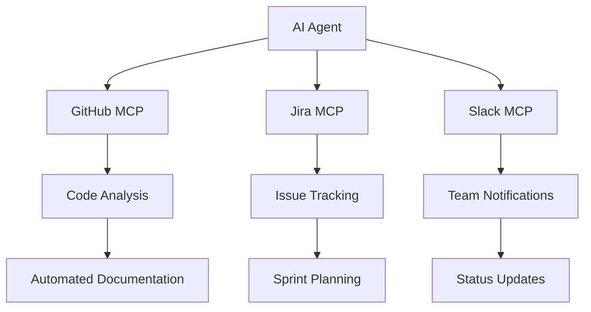

# Advanced Workflows

## Multi-Server Orchestration

### Complex Integration Patterns

- **Chain operations** across multiple MCP servers
- **Data pipeline automation** with AI-driven workflows
- **Cross-platform synchronization** (GitHub → Jira → Slack)
- **Real-time monitoring** with automated alerts

### Enterprise Workflow Examples

---

## Advanced MCP Server Features

### Transport Evolution (2025)

- **Streamable HTTP Transport**: Latest standard replacing stdio
- **Server-Sent Events (SSE)**: For real-time data streaming
- **WebSocket Support**: For bi-directional communication
- **HTTP+SSE**: Deprecated but still supported

### Latest MCP Capabilities

- **Resource Templates**: Dynamic resource generation
- **Progress Notifications**: Long-running operation tracking  
- **Sampling Integration**: Direct LLM sampling within servers
- **Annotation Support**: Content metadata and priority system

---

## Enterprise Adoption Trends

### 2025 Statistics

- **5,000+ deployed MCP servers** globally
- **50K+ GitHub stars** for MCP ecosystem
- **40-70% productivity improvements** in early adopters
- **Major adopters**: Microsoft, OpenAI, Google, AWS, Cloudflare

### Windows 11 Integration

- **Microsoft Build 2025**: "Agentic OS" with native MCP support
- **System-level integration** for Windows applications
- **Enterprise management** through Group Policy
- **Security framework** built into Windows Security

<!-- Speaker Notes:
- Show the rapid evolution of MCP from November 2024 launch to 2025 adoption
- Microsoft's Windows 11 integration represents mainstream enterprise adoption
- The productivity improvements are significant but require proper implementation
- Enterprise workflows can be incredibly complex - MCP makes them manageable
-->